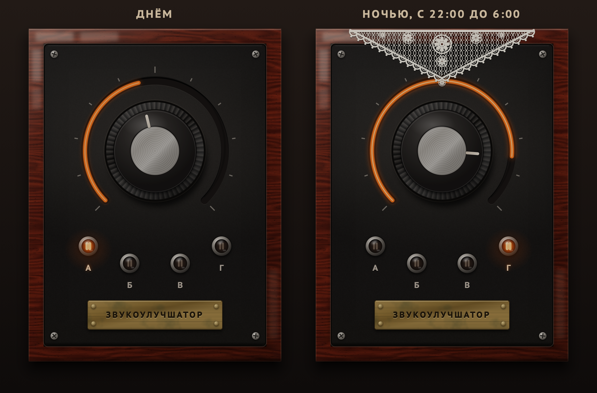
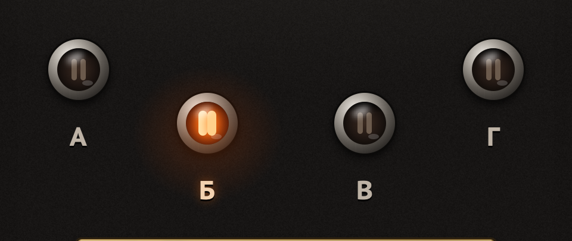
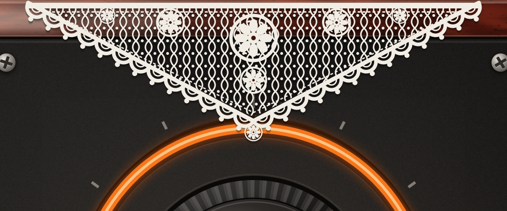

<div align="center">

# ЗВУКОУЛУЧШАТОР

**Одна ручка — и звук становится лучше.**

[](https://github.com/FATnvStudio/zvukouluchshator/releases/latest)
&nbsp;

&nbsp;




</div>

## Что он делает

Крутите ручку вправо, и трек становится плотнее, громче и «дороже». На ноле плагин ничего не трогает, так что сравнивать удобно.

Внутри работает честная звукорежиссёрская цепочка, просто спрятанная за одной ручкой:

- **Три полосы.** Звук делится на низ, середину и верх, и каждая полоса сжимается своим компрессором с мягким коленом. Поэтому бас не «качает» вокал, а тарелки не душат всё остальное.
- **Тёплая сатурация.** Лёгкий ламповый перегруз округляет пики и добавляет гармоник.
- **Лимитер на выходе.** Сколько ни крути, выход не уйдёт за 0 dBFS.
- **Без задержки.** Плагин не добавляет латентности, его можно ставить прямо во время записи.

## Режимы А Б В Г



Режим включается кликом по лампочке. Лампочки неоновые, как в отвёртке-индикаторе: горят оранжевым и чуть мерцают.

| | Характер | Когда пригодится |
|---|---|---|
| **А** | Тепло и мягко, подчёркнут низ | Вокал, акустика, весь микс целиком |
| **Б** | Панч: удар проходит, середина ярче | Барабаны, бас, гитары |
| **В** | Воздух и блеск на верхах | Тусклые записи, бэк-вокал, пэды |
| **Г** | Смэш: жмём сильно, громко, с перегрузом | Когда надо, чтобы «качало» |

Переключение режимов плавное, без щелчков, поэтому их можно менять прямо на ходу и автоматизировать.

## Салфетка



С **22:00 до 6:00** по часам вашего компьютера на ЗВУКОУЛУЧШАТОР плавно опускается связанная крючком салфетка, а утром она так же тихо исчезает. На звук она не влияет. Бабушки одобряют.

## Установка

Скачайте архив для своей системы на странице **[Releases](https://github.com/FATnvStudio/zvukouluchshator/releases/latest)**. Внутри лежит подробная инструкция `INSTALL-*.txt`.

<details>
<summary><b>macOS</b> (Intel и Apple Silicon, macOS 11+): AU и VST3</summary>

1. Скопируйте `AU/Zvukouluchshator.component` в `~/Library/Audio/Plug-Ins/Components/`,
   а `VST3/Zvukouluchshator.vst3` в `~/Library/Audio/Plug-Ins/VST3/`.
   Папка `~/Library` скрыта: в Finder нажмите <kbd>Cmd</kbd>+<kbd>Shift</kbd>+<kbd>G</kbd> и вставьте путь.
2. Плагин пока не нотаризован в Apple, поэтому macOS может сказать, что он «повреждён». Выполните в Терминале:
   ```bash
   xattr -dr com.apple.quarantine ~/Library/Audio/Plug-Ins/Components/Zvukouluchshator.component ~/Library/Audio/Plug-Ins/VST3/Zvukouluchshator.vst3
   ```
3. Перезапустите DAW. Плагин находится у производителя **nvStudio**.

</details>

<details>
<summary><b>Windows</b> (10/11, 64 бита): VST3</summary>

1. Правый клик по скачанному zip → **Свойства** → галочка **Разблокировать** → ОК, затем распакуйте.
2. Скопируйте папку `VST3\Zvukouluchshator.vst3` в `C:\Program Files\Common Files\VST3\`.
3. Перезапустите DAW. Плагин находится у производителя **nvStudio**.

В архиве также лежит отдельная программа (`Standalone`), чтобы попробовать плагин без DAW.

</details>

## Управление

| Действие | Как |
|---|---|
| Улучшить | Тянуть ручку мышкой вверх или крутить колёсико |
| Сбросить в ноль | Двойной клик по ручке |
| Сменить режим | Клик по лампочке |
| Сделать окно больше | Тянуть за правый нижний угол, пропорции сохраняются |

Всё автоматизируется в DAW: параметры «Улучшение» и «Режим».

## Проверено в

Ableton Live 12 (macOS). Если плагин работает или не работает в вашей DAW, напишите в [Issues](https://github.com/FATnvStudio/zvukouluchshator/issues).

---

<div align="center">

Сделано в **nvStudio** · интерфейс целиком нарисован кодом, без единой картинки

<sub>Шрифт таблички — PT Sans Caption © ParaType, распространяется по ParaType Free Font License.<br>
Плагин бесплатный. Исходный код закрыт, здесь публикуются только готовые сборки.</sub>

</div>
